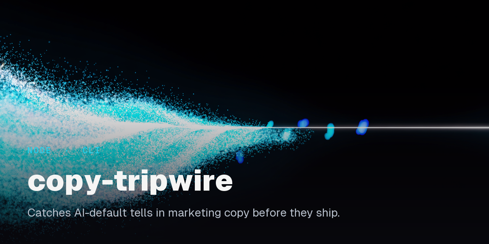

<p align="center"></p>

# copy-tripwire

Pattern-checker for marketing copy. Sibling to [`trailer-tripwire`](https://github.com/EthanY33/trailer-tripwire) and [`screenshot-tripwire`](https://github.com/EthanY33/screenshot-tripwire). Catches measurable AI-default tells before they ship: overused phrases ("delve", "tapestry", "supercharge"), em-dash overdose, fabricated roadmap items, over-bulleting.

This is a **pattern checker**, not a taste checker. It catches mistakes; it does not know whether the writing is good.

## Why

AI-assisted prose drifts toward a recognisable house style: heavy em-dashes, "supercharge your workflow", "delve into the inner workings", "we're working on more zones, coming soon". Each tell is small. Together they make a launch-page reek of copy-paste output and erode trust with the audiences you most need to keep: recruiters, store browsers, fellow developers. This tool fails the build before that copy hits production.

## Install

```bash
# As a devDependency, pinned to a specific commit (matches trailer-tripwire pattern)
npm install --save-dev https://github.com/EthanY33/copy-tripwire/archive/<commit-sha>.tar.gz

# Or directly via the registry once published (not yet)
npm install --save-dev copy-tripwire
```

## Usage

```bash
# Audit specific files (Markdown, HTML, plain text)
npx copy-tripwire audit path/to/post.md path/to/landing.html

# JSON output (for piping into another tool)
npx copy-tripwire audit --json path/to/post.md

# Cross-check version mentions against your version.json
npx copy-tripwire audit --patch-history brand/goneidle-landing/version.json path/to/post.md

# Tune thresholds per project
npx copy-tripwire audit --max-em-dash 5 --max-bullets 12 path/to/post.md

# Audit everything currently staged under brand/goneidle-landing/
npx copy-tripwire check

# Install pre-commit hook (shares the file with trailer-tripwire / screenshot-tripwire gates)
npx copy-tripwire install-hooks

# Short alias
npx ct audit post.md
```

Wire into your project's `package.json`:

```json
{
  "scripts": {
    "copy:audit": "copy-tripwire audit",
    "copy:check": "copy-tripwire check",
    "copy:install-hooks": "copy-tripwire install-hooks"
  }
}
```

Exit codes: `0` if no CRITICAL findings, `2` if any CRITICAL, `64` on a usage error.

`audit` options take `--name value` or `--name=value`. An unknown option, or a value that is missing or not a number, is a usage error and nothing is audited. Put `--` before a file name that starts with `--`.

## Heuristics

| Code | Level | Catches |
|---|---|---|
| `BANNED_PHRASE` | CRITICAL | One of the AI-overused phrase list (case-insensitive whole-word match) |
| `UNLISTED_VERSION` | CRITICAL | A `vN.N.N` mention that's NOT in `--patch-history` JSON (cross-check). Skipped if no `--patch-history` provided. A leading `v` in the history is ignored, and `N.N` is read as `N.N.0` on both sides. |
| `EM_DASH_DENSITY` | WARN | More em-dashes (U+2014) per 100 words than threshold (default 3) |
| `OVER_BULLETED` | WARN | More bullet items per 100 words than threshold (default 8); counts both Markdown and HTML `<li>` |
| `ROADMAP_PHRASE` | WARN | Future-tense roadmap markers ("coming soon", "we're working on", "in development", etc.) |
| `EMPTY_FILE` | WARN | 0-byte file |
| `AUDIT_FAIL` | CRITICAL | The file could not be audited (unreadable, not a regular file, not decodable as text, or larger than 5 MB) |

### Banned phrase list

| Phrase | Why |
|---|---|
| delve | AI-default verb |
| tapestry | AI cliche |
| ever-evolving / ever evolving | AI cliche |
| in the fast-paced world / in the fast paced world | Hallmark AI opener |
| supercharge | AI marketing verb |
| unleash | AI marketing verb |
| seamlessly | AI cliche |
| elevate | AI marketing verb |
| dive deep into | AI cliche |
| game-changer / game changer | AI cliche |
| unlock the power of | AI cliche |
| harness the power | AI cliche |

Edit `lib/audit.mjs` to add or remove entries for your project. Each entry is `{ pattern, hint }`. `pattern` is a JS regex source, `hint` is the message shown in the deny output.

### Roadmap markers

These don't always indicate a fabricated commitment, so they're WARN not CRITICAL. They flag for human review.

| Phrase | Why flagged |
|---|---|
| coming soon | Vague future commitment without a date |
| in the next release | Should tie to a specific version |
| planned for | Specific feature or omit |
| we're working on | If not in the next release, leave out |
| ongoing / still ongoing / currently ongoing | Vague status |
| in development / in active development | Vague status |
| next up: | Roadmap teaser |

### Why text extraction matters

- HTML `<script>` and `<style>` bodies are stripped before phrase matching, so a banned phrase appearing in a CSS class name or JS string literal does NOT trip the audit.
- Markdown fenced code blocks (`` ``` ``) and inline code (`` ` ``) are stripped, so code samples can use any phrase without tripping the prose audit.
- HTML tags are stripped to prose before word-counting, so density metrics reflect what readers see, not the markup. A `<` that does not open a tag (`< 5 minutes`, `<3`) stays in the prose.
- HTML entities are decoded (`&mdash;`, `&#8212;`, `&rsquo;` and the like) and a line break inside a phrase counts as a space, so entity-encoded or hard-wrapped copy is matched the way it reads.

## File handling

Auto-detected by extension and content sniffing:
- `.html` / `.htm` → HTML extraction
- `.md` / `.markdown` → Markdown extraction, then HTML extraction (for HTML embedded anywhere in the file)
- everything else → plain text

`.txt`, `.rtf`-as-text, and unknown extensions go through the plain-text path: no extraction, just direct phrase matching.

Encoding: `audit` reads files as UTF-8 (a byte-order mark is ignored) and also decodes UTF-16 that starts with a byte-order mark. `check` reads staged files as UTF-8 only. Anything else (UTF-16 without a mark, Windows-1252, binary) is a CRITICAL `AUDIT_FAIL`, never a clean result on garbled text.

## Pre-commit hook

The `install-hooks` command writes a `pre-commit` hook into the directory git actually uses (`git rev-parse --git-path hooks`, so `core.hooksPath` and linked worktrees are honoured). The hook audits any staged `.md` / `.html` / `.htm` / `.txt` files under `brand/goneidle-landing/` and blocks the commit on any CRITICAL finding.

The gate is a managed block between `# copy-tripwire:v1` and `# copy-tripwire:v1 end`, running `npx --no -- copy-tripwire check || exit $?`. `--no` stops npx from downloading anything from the registry, and `|| exit $?` blocks the commit even when the hook has no `set -e`.

Hooks from `trailer-tripwire` and `screenshot-tripwire` use the same block format, so all three gates live in one file and every installer rewrites only the lines between its own markers:

- Re-running is **idempotent**: an equal block leaves the file byte-identical, and sibling blocks and your own lines are never touched.
- A hook written by an older installer (solo or composed) is rewritten as one block per gate, in the order screenshot, trailer, copy. A `--dir` given to `trailer-tripwire` is carried over.
- A hand-written hook that already mentions a tripwire gets the copy-tripwire block appended. If a line above it starts with `exec`, or is an unconditional `exit`, the installer warns that the block will never run.
- A hook with no tripwire in it is **refused** and left unmodified. The message prints the three lines to add by hand.

If a `brand/goneidle-landing/version.json` exists in the repo, the pre-commit hook reads it automatically and uses its `patchHistory[].version` (or `versions[]`, or root-array, or top-level `version`) for `UNLISTED_VERSION` detection.

To bypass on a one-off: `git commit --no-verify` and document why in the message.

## Adapting heuristics

Heuristics live in `lib/audit.mjs`. Tune thresholds when:
- A real, intentionally-used phrase trips a CRITICAL → remove from the banned list, or downgrade to WARN
- A bad phrase slips through → add to the banned list with a hint
- The em-dash / bullet density triggers on legit copy → raise the threshold via `--max-em-dash N` / `--max-bullets N` or change the default

The thresholds are defaults from a small calibration set. Yours may differ.

## Roadmap

Items I'd add only if a real failure case appears:

- Sentiment / tone audit (currently out of scope; the tool is pattern-only)
- Reading-level check (Flesch-Kincaid or similar)
- Trademark / brand-voice deviations (project-specific lexicons)
- "AI-watermark" pattern matching beyond phrase list (sentence-shape statistics)
- Programmatic Node API documentation (the lib modules are already importable)

## License

MIT. See [LICENSE](LICENSE).
